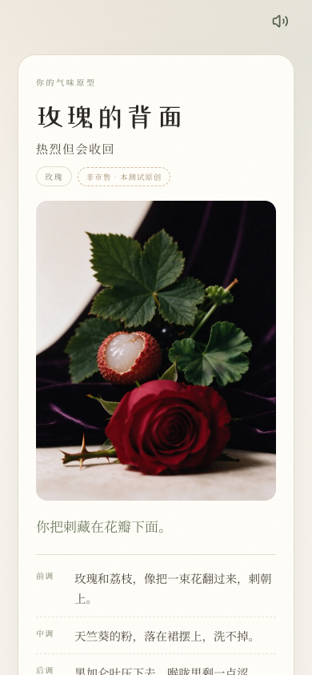
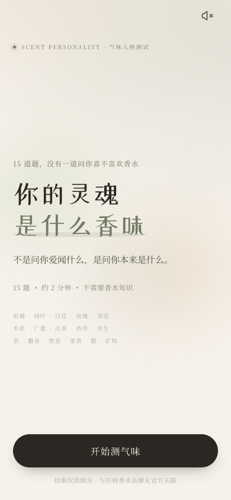

# 测测你的灵魂是什么香味

一份为香水爱好者和好奇自己气味风格的人做的 15 题趣味测试。回答日常场景里的选择，约两分钟后就能看到自己的气味原型、前中后调，以及可以继续探索的香调建议。

## 为什么做这个测试

第一次挑香水，很容易被香调术语和一整排瓶子难住。我想从更容易回答的问题开始：朋友临时取消约会时，你是什么反应？一个人的理想周末是什么样？把这些日常偏好变成一份气味画像，让人更容易说出「我想闻起来是什么感觉」，也给接下来试香一个方向。

## 能做什么

- **用日常选择完成 15 道题。** 每次显示一题和当前进度，可以返回上一题修改答案。背景音乐可随时关闭。
- **读懂自己的气味原型。** 从 16 种原创原型中得到主结果，查看前调、中调、后调和用香建议，也可展开第二人格香。
- **把结果留在手机里。** 结果页可以生成分享卡、保存图片，或重新开始测试。

## 从开始到结果

点击「开始测气味」，按自己的习惯选完 15 题。结果页会先展示主要气味原型，再给出香调和解读。想看另一种与自己接近的气味，可以点击「看看我的第二人格香」。

*演示使用虚构答案。气味画像供娱乐与试香参考。*
